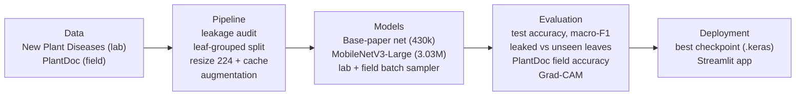
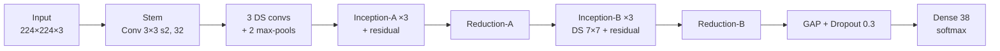
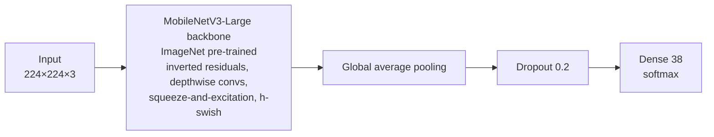
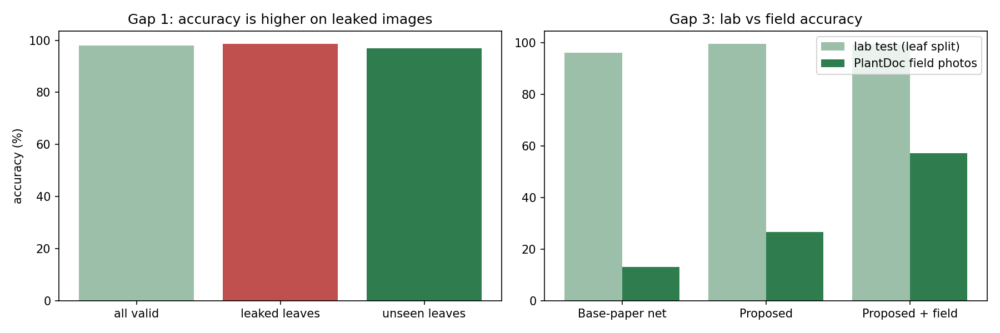
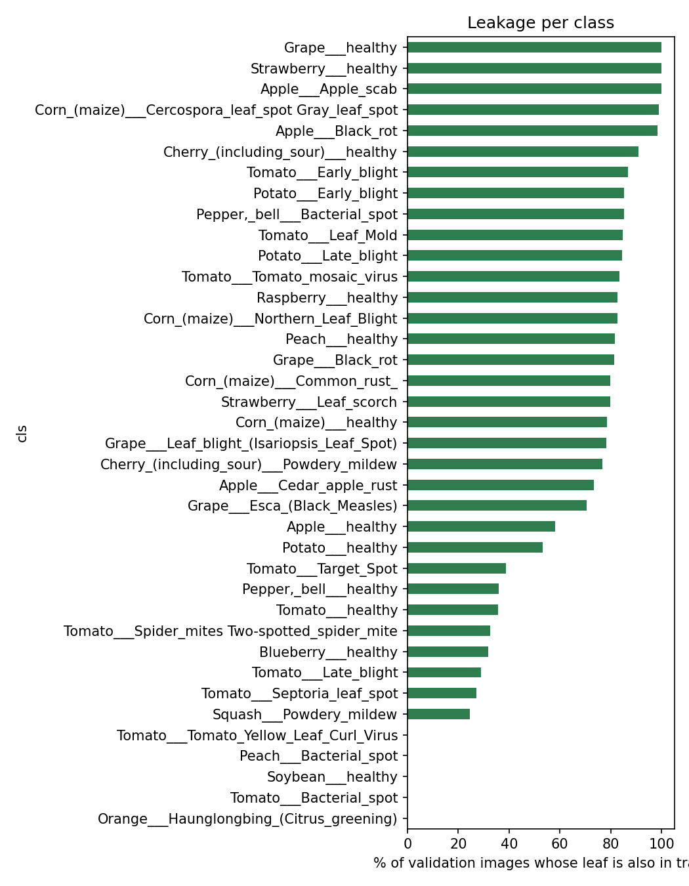
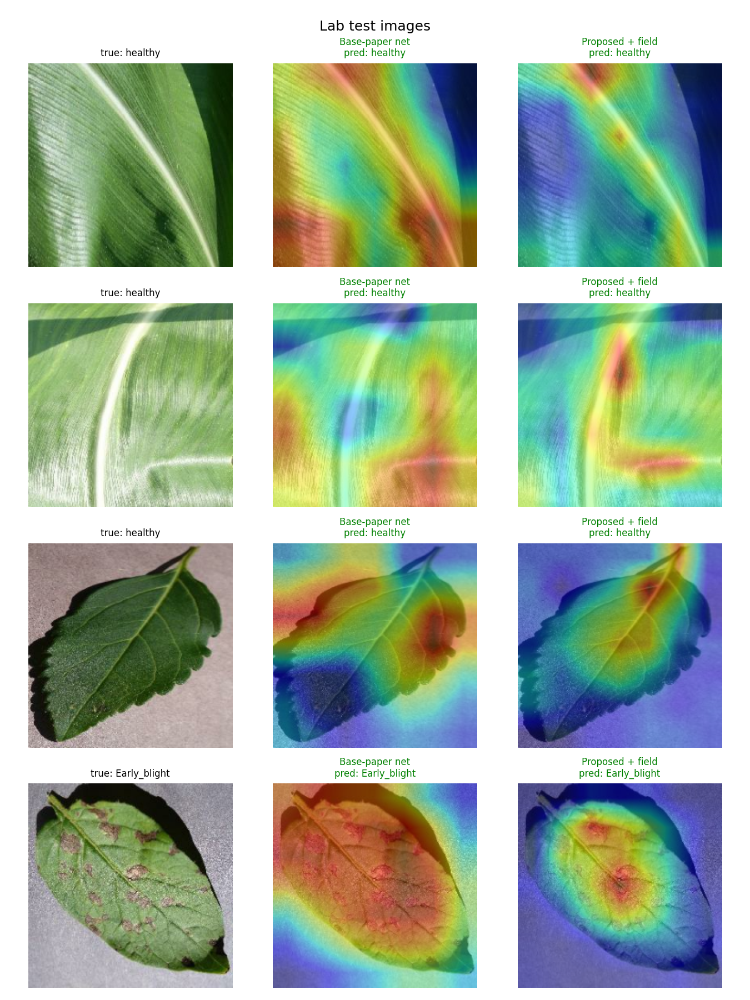
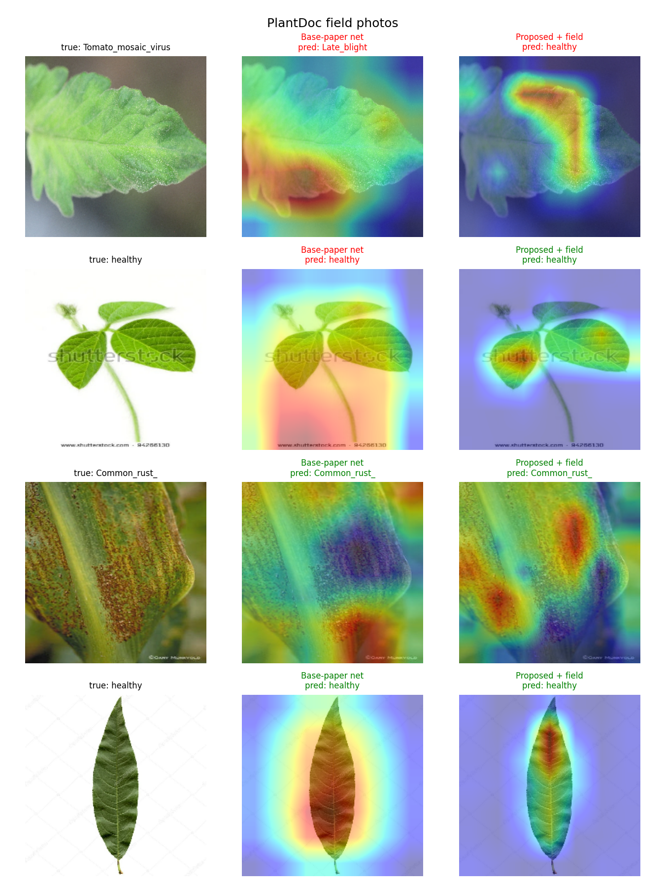

# Plant Disease Recognition: Filling the Research Gaps of an IEEE Base Paper

Build a plant-disease classifier that is **evaluated honestly**, **works on field photos** and **explains its decisions**.

**Authors:** Revant Shukla (RA2311033010171) · Krish Shewarmani (RA2311033010148)

---

## Base paper

> S. M. Hassan and A. K. Maji, "Plant Disease Identification Using a Novel Convolutional Neural Network," *IEEE Access*, vol. 10, pp. 5390–5401, 2022. doi:10.1109/ACCESS.2022.3141371

The base paper proposes a lightweight CNN that combines Inception blocks, residual connections and depthwise separable convolutions in **428,100 parameters**. It reports **99.39%** accuracy on PlantVillage (corn, potato and tomato classes). It uses a random 80:20 split, and the same 20% serves as both the validation set and the test set.

## Research gaps

| # | Gap in the base paper | Why it matters | Status |
|---|---|---|---|
| G1 | Random 80:20 image split; validation set = test set | Copies of one leaf leak into the test set, so accuracy is inflated | **Filled** |
| G2 | Only 3 crops of PlantVillage | A real app must cover every class | Covered (all 38 classes) |
| G3 | No lab-to-field test | Lab accuracy may not transfer to field photos | **Filled** |
| G4 | No background-shortcut check | The model may learn the background, not the disease | Future work |
| G5 | "Lightweight" shown only by parameter count | Phones need small, fast models | Future work |
| G6 | No explanation of predictions | Users need visual evidence | **Filled** |
| G7 | Always names a disease; confidence not calibrated | Non-leaf photos get confident labels | Future work |

### How the gaps were filled

- **G1: leakage-free evaluation.** The dataset was made by rotating and flipping PlantVillage photos, and each copy keeps the source file name plus a suffix (`_flipLR`, `_90deg`, …). Removing the suffix gives a **leaf ID**. We audit the standard split, then split **by leaf** into 70% train / 15% validation / 15% test. The test set is used once.
- **G3: lab-to-field generalisation.** Every model is tested on **PlantDoc** field photos. We fine-tune **MobileNetV3-Large** (ImageNet pre-trained) and mix PlantDoc training photos into about **15% of every training batch**.
- **G6: explainability.** **Grad-CAM** heat-maps show which part of the image drove each prediction, in the notebook and in the web app.

---

## Datasets

| Dataset | Images | Notes |
|---|---|---|
| [New Plant Diseases (augmented PlantVillage)](https://www.kaggle.com/datasets/vipoooool/new-plant-diseases-dataset) | 87,867 · 38 classes · 14 crops | Lab photos on plain backgrounds; only 49,426 distinct leaves |
| [PlantDoc](https://github.com/pratikkayal/PlantDoc-Dataset) | 2,342 train · 236 test (mapped classes) | Real-world field photos; test photos used only for evaluation |

**Leaf-grouped split:**

| Split | Images | Distinct leaves | Used for |
|---|---|---|---|
| Train (70%) | 61,426 | 34,582 | Learning the weights |
| Validation (15%) | 13,237 | 7,413 | Choosing the best epoch |
| Test (15%) | 13,204 | 7,431 | Final score, used once |

---

## Project architecture



**Tech stack:** Python · TensorFlow / Keras · Google Colab (NVIDIA T4 GPU) · Google Drive · scikit-learn · Matplotlib · Streamlit

## Workflow and experiments


| Exp. | Model | Training data | Purpose |
|---|---|---|---|
| E1 | Base-paper net | Original train / valid folders | Measure the leakage effect (G1) |
| E2 | Base-paper net | Leaf-grouped split | Honest baseline + field test |
| E3 | MobileNetV3-Large (proposed) | Leaf-grouped split, lab only | Effect of transfer learning |
| E4 | MobileNetV3-Large + field mixing | Leaf split + PlantDoc (15% of each batch) | Fill G3 |

---

## Model architectures

### Model A: base-paper network (re-implemented)

Follows Section III-D and Fig. 5 of the base paper. The paper does not list filter widths, so they were chosen to match its size (**430,058** parameters vs 428,100 reported).



*DS = depthwise separable convolution. BatchNorm + ReLU after every convolution. Trained from scratch.*

### Model B: proposed MobileNetV3-Large with transfer learning



- **Stage 1 (1 epoch):** backbone frozen, only the new head trains (Adam, LR 1e-3).
- **Stage 2 (3 epochs):** all layers fine-tuned except BatchNorm (Adam, LR 1e-4).
- Cross-entropy with **label smoothing 0.1** · 3,032,870 parameters.

### Training setup

| Setting | Base-paper net (E1, E2) | Proposed (E3, E4) |
|---|---|---|
| Initialisation | Random (from scratch) | ImageNet pre-trained |
| Input / batch | 224 × 224 RGB, batch 64 | 224 × 224 RGB, batch 64 |
| Optimizer | Adam, LR 1e-3 (resume 3e-4) | Adam, 1e-3 head, then 1e-4 |
| Loss | Cross-entropy | Cross-entropy + label smoothing 0.1 |
| Epochs | E2: 4 (planned 10; free-GPU limit) | 1 + 3 (two stages) |
| Augmentation | Random flip, brightness, contrast | Random flip, brightness, contrast |
| Model selection | Best validation accuracy | Best validation accuracy |

---

## Results

| Experiment | Lab test acc. | Macro-F1 | PlantDoc field acc. | Params |
|---|---|---|---|---|
| E1 Base-paper net, usual split | 97.97%* | – | 13.98% | 430k |
| E2 Base-paper net, leaf split | 96.11% | 96.12% | 13.14% | 430k |
| E3 Proposed, lab only | **99.54%** | 99.52% | 26.69% | 3.03M |
| E4 Proposed + field mixing | 99.34% | 99.34% | **57.20%** | 3.03M |

\* E1 is scored on the original validation folder, which contains leaked images. Chance level for 38 classes is 2.6%. Full table: [`results/results_table.csv`](results/results_table.csv).

**Key findings**

- **G1:** 61.1% of the standard validation set (10,739 of 17,572 images) are rotated or flipped copies of training leaves. E1 scores **98.60%** on leaked leaves but **96.99%** on unseen leaves. That is an error rate of 1.40% vs 3.01%, so the model makes about **2.1× more errors** on leaves it has never seen.
- **G3:** the base-paper network falls from 96% in the lab to **13%** on field photos. Our model doubles field accuracy to 27%, and field mixing raises it to **57.2% (4.4×)** while keeping **99.3%** lab accuracy.
- **G6:** Grad-CAM shows that our model focuses on lesions, while the base-paper network often attends to the background.



| Leakage per class | Grad-CAM (lab) | Grad-CAM (field) |
|---|---|---|
|  |  |  |

In the Grad-CAM figures, green titles are correct predictions and red titles are wrong ones. The titles show only the disease name, so a red "healthy" means the wrong crop.

---

## Repository structure

```
notebooks/Plant_Disease_Gap_Filling.ipynb   full pipeline: data, leakage audit, split, models, E1–E4, results, Grad-CAM
app.py                                      Streamlit app (top-3 prediction + Grad-CAM heat-map)
app_model/                                  trained E4 model (model.keras) + class names (meta.json)
scripts/leakage_audit.py                    standalone leakage audit for the dataset folders
results/                                    result table and figures from our run
requirements.txt                            packages for running the app locally
```

## How to run

### 1. Train and evaluate (Google Colab)

1. Open `notebooks/Plant_Disease_Gap_Filling.ipynb` in [Google Colab](https://colab.research.google.com/).
2. Choose **Runtime → Change runtime type → T4 GPU**.
3. Choose **Runtime → Run all**, and allow Google Drive access when asked.

The notebook downloads both datasets itself, with no Kaggle login needed. Models and results are saved to `MyDrive/plant_project/results`. If Colab disconnects, run it again: finished experiments are skipped and an interrupted one resumes from its checkpoint. Set `QUICK = True` in the first cell for a 10-minute test run.

### 2. Run the web app

The trained model (E4: MobileNetV3-Large + field mixing) is included in `app_model/`.

```bash
pip install -r requirements.txt
streamlit run app.py
```

Upload a leaf photo to get the top-3 predicted diseases with confidence and a Grad-CAM heat-map.

### 3. Leakage audit only

```bash
python scripts/leakage_audit.py "path/to/New Plant Diseases Dataset(Augmented)"
```

---

## Limitations

- The base-paper network is re-implemented from the paper's description, so its filter widths may differ from the original.
- It was trained for fewer epochs than the paper (E2: 4 vs 50) because of free-GPU limits.
- The PlantDoc test set is small (236 photos) and comes from the same source as the field training photos.
- The proposed model is larger (3.03M vs 430k parameters).

## Future work

- **G4:** background randomisation and a background-only shortcut test.
- **G5:** an INT8 TensorFlow Lite model, with size and speed measured on Android phones.
- **G7:** calibrated confidence and a "not sure, retake the photo" answer for unknown images.
- Pathologist-labelled field photos from Indian farms.

## References

1. S. M. Hassan and A. K. Maji, "Plant disease identification using a novel convolutional neural network," *IEEE Access*, vol. 10, pp. 5390–5401, 2022.
2. S. P. Mohanty, D. P. Hughes and M. Salathé, "Using deep learning for image-based plant disease detection," *Frontiers in Plant Science*, vol. 7, 1419, 2016.
3. L. Li, S. Zhang and B. Wang, "Plant disease detection and classification by deep learning—A review," *IEEE Access*, vol. 9, pp. 56683–56698, 2021.
4. A. Ahmad, A. El Gamal and D. Saraswat, "Toward generalization of deep learning-based plant disease identification under controlled and field conditions," *IEEE Access*, vol. 11, pp. 9042–9057, 2023.
5. R. Maurya et al., "Plant disease classification using interpretable vision transformer network," *IEEE REEDCON*, 2023, pp. 688–692.
6. D. Singh et al., "PlantDoc: A dataset for visual plant disease detection," *ACM CoDS-COMAD*, 2020, pp. 249–253.
7. M. A. Noyan, "Uncovering bias in the PlantVillage dataset," arXiv:2206.04374, 2022.
8. A. Howard et al., "Searching for MobileNetV3," *IEEE/CVF ICCV*, 2019, pp. 1314–1324.
9. R. R. Selvaraju et al., "Grad-CAM: Visual explanations from deep networks via gradient-based localization," *IEEE ICCV*, 2017, pp. 618–626.
